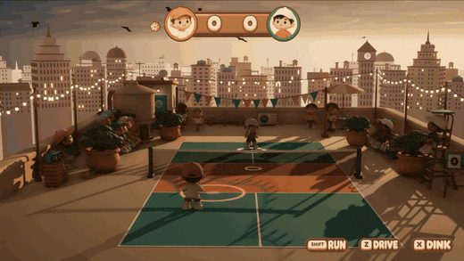
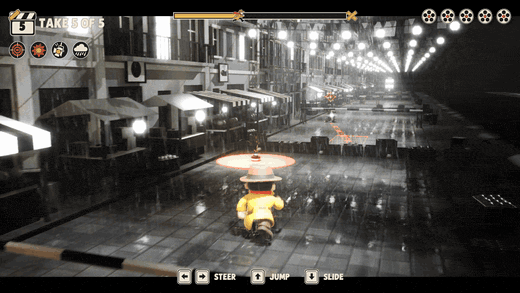
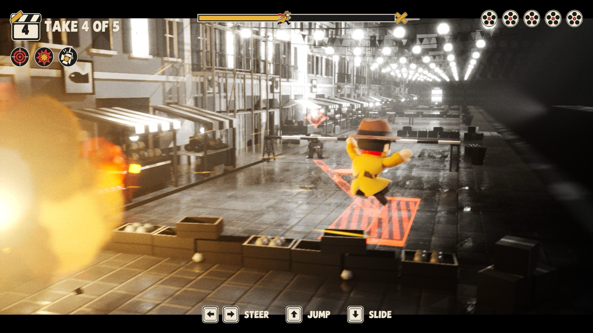
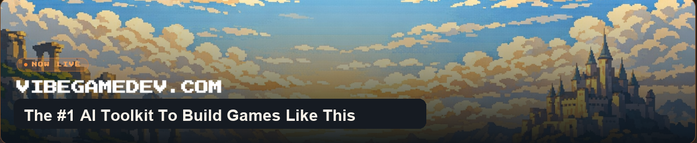

<div align="center">

# Agent Skill for Unreal Engine 5.9 Preview

### Field lessons for building and shipping an Unreal Engine 5.9 game with a coding agent.

An **Agent Skill** in the open `SKILL.md` format, laid out for **Claude Code** (`.claude/skills`) and for **Codex** and other agents that read `.agents/skills`. It was written while Claude Fable 5.2 took a small sports game from a greybox to Mac, iPhone and web builds over Unreal's built-in MCP server, and it grew while Claude Fable 5.2 made a second game, **One More Take**, for a game jam and packaged it for Windows and Mac.

<br>

[](https://www.vibegamedev.com/?utm_source=github&utm_medium=readme_badge&utm_campaign=unreal-5.9-skill)

[**▶ Watch the video**](https://www.youtube.com/watch?v=0G8air5h3_s) &nbsp;·&nbsp;
[**Read the skill**](.claude/skills/unreal-5-9/SKILL.md) &nbsp;·&nbsp;
[**Install it**](#install-it) &nbsp;·&nbsp;
[**▶ Play Rooftop Rally**](https://rooftop-rally.vercel.app) &nbsp;·&nbsp;
[**▶ Play One More Take**](https://aioriented.itch.io/one-more-take) &nbsp;·&nbsp;
[**Learn to build games like this**](https://www.vibegamedev.com/?utm_source=github&utm_medium=readme_links&utm_campaign=unreal-5.9-skill)


<br>




</div>

---

## The skill

Unreal Engine 5.9 ships an MCP server inside the editor (the `ModelContextProtocol` plugin, shown as "Unreal MCP"). An agent can call editor tools through it and run editor Python. Epic documents the tools. This skill is the part Epic's reference leaves out: what happened when an agent used them to build a whole game, and what to do about it.

- **A game an agent can play.** Console-variable twins for every input, simulated keys, pads and fingers through the real input stack, and probes that read the result back, so play can be scripted and asserted on.
- **Measured, not guessed.** Each lesson gives the rule first and the number that was measured second, and says whether it was run on 5.9, read in the engine source, or carried over from 5.8.
- **From an empty project to four platforms.** Setup and the editor lifecycle, importing glTF characters and environments, animation driven from C++, a canvas HUD, sound and its mix, captures and frame-exact footage, then packaging for Mac, Windows, iOS (through TestFlight) and the web.
- **Working beside a person.** What went wrong when agents shared a Mac with someone playing in the editor (a mouse taken, a relaunch in the middle of a game) and the rules that came of it: runs off screen, a game that never takes the mouse in those runs, and play you did not start left alone.
- **The traps.** An editor that answers while it is frozen, a port that stays unbindable after a quit, return values that report success for work that did not happen, and a packaged build that draws a different picture from the editor.

## Install it

Clone the repository, then copy the skill folder to where your agent looks for skills.

```sh
git clone https://github.com/chongdashu/unreal-5.9-skill.git

# Claude Code, for one project
mkdir -p /path/to/your-project/.claude/skills
cp -R unreal-5.9-skill/.claude/skills/unreal-5-9 /path/to/your-project/.claude/skills/

# Claude Code, for every project on this machine
mkdir -p ~/.claude/skills
cp -R unreal-5.9-skill/.claude/skills/unreal-5-9 ~/.claude/skills/

# Codex and other agents that read .agents/skills
mkdir -p /path/to/your-project/.agents/skills
cp -R unreal-5.9-skill/.agents/skills/unreal-5-9 /path/to/your-project/.agents/skills/
```

Start a new session in the project. The agent loads the skill by itself when the work is about Unreal. You can also call it by name: `/unreal-5-9` in Claude Code, `$unreal-5-9` in Codex.

## What you need

- Unreal Engine 5.9 Preview with the `ModelContextProtocol`, `AllToolsets` and `PythonScriptPlugin` plugins enabled in the project.
- Python 3 for the helper scripts. The MCP client uses the standard library only; the capture cropper needs Pillow.
- A coding agent that loads Agent Skills, such as Claude Code or Codex.
- macOS for the shell helpers (`ue_wait.sh`, `ue_relaunch.sh`, `capture_notice.sh`). Everything was run on macOS 26.6 on Apple Silicon, except the Windows package, which a Windows PC built and checked. Nothing here was run on Linux.
- For a Windows package, a Windows PC with Visual Studio 2022's C++ tools and the launcher's 5.9. A Mac cannot package Win64.
- For the web build, an engine source checkout and Emscripten. The launcher's install refuses the Wasm platform.

## What's here

| Path | What it is |
| --- | --- |
| [`.claude/skills/unreal-5-9/`](.claude/skills/unreal-5-9) | The skill, where Claude Code finds it |
| [`.agents/skills/unreal-5-9/`](.agents/skills/unreal-5-9) | The same files, byte for byte, where Codex and other agents find it |
| [`SKILL.md`](.claude/skills/unreal-5-9/SKILL.md) | The method, the order that worked, the verification ladder and the anti-patterns |
| [`references/`](.claude/skills/unreal-5-9/references) | One file per job, with the measured detail |
| [`scripts/`](.claude/skills/unreal-5-9/scripts) | A small MCP client (`uemcp.py`), wait and relaunch helpers, a capture cropper, a capture notice and an editor script template |

The reference files, by job:

| Job | File |
| --- | --- |
| A new project, launching, the log, the handshake, `.mcp.json` | [`setup-and-lifecycle.md`](.claude/skills/unreal-5-9/references/setup-and-lifecycle.md) |
| Editor scripts: levels, Play In Editor, readbacks, what Python refuses | [`editor-python.md`](.claude/skills/unreal-5-9/references/editor-python.md) |
| Test hooks in C++, probes, compile checks, headless runs | [`drivable-game.md`](.claude/skills/unreal-5-9/references/drivable-game.md) |
| Importing `.glb` meshes, characters and clips; sockets; materials; sky | [`import-and-materials.md`](.claude/skills/unreal-5-9/references/import-and-materials.md) |
| Animation from C++: cross-fades, legs under a swing, hit timing | [`animation.md`](.claude/skills/unreal-5-9/references/animation.md) |
| A menu and HUD on the canvas; keys, pads, touch, a phone's safe area | [`hud-and-input.md`](.claude/skills/unreal-5-9/references/hud-and-input.md) |
| Importing sound and checking it from a recording | [`sound.md`](.claude/skills/unreal-5-9/references/sound.md) |
| Captures, exposure, framing, frame-exact footage | [`capture-and-recording.md`](.claude/skills/unreal-5-9/references/capture-and-recording.md) |
| Several agent sessions on one editor, and the person whose Mac it is | [`sharing-an-editor.md`](.claude/skills/unreal-5-9/references/sharing-an-editor.md) |
| A standalone Mac app, a Windows package, and what every package shares | [`packaging.md`](.claude/skills/unreal-5-9/references/packaging.md) |
| An iPhone: building, signing, running on a device, its look, TestFlight and the App Store | [`ios.md`](.claude/skills/unreal-5-9/references/ios.md) |
| A web build (Wasm, WebGPU), hosting it, play stats from it | [`web.md`](.claude/skills/unreal-5-9/references/web.md) |
| Arriving from 5.8 | [`from-5.8.md`](.claude/skills/unreal-5-9/references/from-5.8.md) |

In a few places the skill points to other skills: `unreal-5-8` for the older engine, `asc` and `capacitor-ios` for the App Store steps that do not depend on the engine, and `music` and `sound-effects` for generated audio. They are not in this repository.

## The games it built

### Rooftop Rally

**Rooftop Rally** is a pickleball match on a rooftop at sunset: one player against the computer, first to five. It runs as a Mac app, on an iPhone and [in a browser](https://rooftop-rally.vercel.app) through Unreal 5.9's Wasm and WebGPU platform. The build is shown in [this video](https://www.youtube.com/watch?v=0G8air5h3_s).

### One More Take



**One More Take** is a runner on a film set. You are the stunt double, and before every take the director adds something worse: gunmen, explosions, rain. It was made solo in four days for the 2026 Epic AI MegaJam and packaged for Windows and Mac. Its lessons are new in this version of the skill: the Windows package, the mix, lights made in code, and agents sharing a Mac with the person playing in the editor.

[Play it on itch.io](https://aioriented.itch.io/one-more-take) &nbsp;·&nbsp;
[Watch the gameplay](https://www.youtube.com/watch?v=DanGaf17XmI) &nbsp;·&nbsp;
[Read the dev log](https://chongdashu.github.io/one-more-take-devlog/)

Both games' console variables, classes and folders appear in the skill under stand-in names (`game.`, `MyGame`), so the lessons read the same for your project. This repository holds the skill only; neither game's source is here.

<div align="center">

<br>

## Build games like this with AI

This repository is one agent skill. **VibeGameDev** teaches the whole method: how to direct a coding agent through mockups, models, animation and launch, with the project templates, skills and source of games like this one.

[](https://www.vibegamedev.com/?utm_source=github&utm_medium=readme_footer&utm_campaign=unreal-5.9-skill)

**[vibegamedev.com](https://www.vibegamedev.com/?utm_source=github&utm_medium=readme_footer&utm_campaign=unreal-5.9-skill)**

<br>

Made by **Chong-U** &nbsp;·&nbsp;
[𝕏 @chongdashu](https://x.com/chongdashu) &nbsp;·&nbsp;
[YouTube @AIOriented](https://youtube.com/@AIOriented) &nbsp;·&nbsp;
[GitHub @chongdashu](https://github.com/chongdashu)

<sub>Brought to you by [vibegamedev.com](https://www.vibegamedev.com/?utm_source=github&utm_medium=readme_footer&utm_campaign=unreal-5.9-skill)</sub>

</div>

## Licence

The skill, its notes and its scripts: [MIT](LICENSE). The game images and the VibeGameDev artwork in `.github/assets`: [CC BY-NC 4.0](CONTENT-LICENSE.md).
